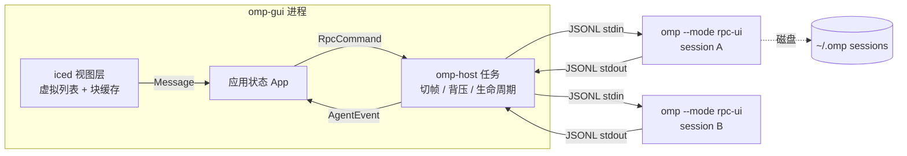

# omp GUI 蓝图（Rust + iced 原生桌面版）

> **2026-11-01 修订**：§2（iced 选型）与 §9（不做内置终端/WebView）已被推翻，UI 栈改为 **Tauri 2 + React**（内置终端 + 网页预览为硬需求）。权威文档：`docs/superpowers/specs/2026-11-01-omp-x-frontend-design.md`（§0 有逐条修订对照）。§0 协议实测事实、§3 host 分层、§4 主机层四件事、§6 里程碑顺序、§7 安全约束继续有效。M1 实现计划：`docs/superpowers/plans/2026-11-01-m1-host.md`。

给 [omp（Oh My Pi）](https://github.com/can1357/oh-my-pi) 做图形界面外壳的设计与选型。

**已定**：UI 层锁定 **Rust + iced**，不复用 Web UI，不用 WebView / Electron / Tauri。（⚠️ 见上方修订注：此行已过时）

三条前置结论：

1. **不重写 agent**。omp 已提供 `--mode rpc` 与 `--mode rpc-ui`（同线协议，后者把会话标记为 UI-capable 并接上依赖 UI 的工具/扩展面板）。GUI 的不可省略职责是**应答 `extension_ui_request`**。
2. **进程内直连子进程**。没有本地 HTTP/WS 服务 → 无端口、无 token、无浏览器攻击面。
3. **代价提前认**：Markdown 排版、语法高亮、diff、文本选择在 Web 上是白送的，原生要从零搭，开发量约 3–5 倍。换到的是：冷启动 <300ms、常驻内存低一个量级、真实 IME 与原生命令行集成、无 GC 抖动。

---

## 0. 实测协议事实（omp 18.4.3，本机抓取，非文档转述）

这是本蓝图的锚点。凡与之冲突的 README 一律以实测为准。

**握手**

```json
{"type":"ready","protocolVersion":1,"supportedProtocolVersions":[1,2],
 "maxFrameBytes":1048576,"maxReassembledFrameBytes":67108864}
```

默认协商到 v1；发 `{"type":"negotiate_protocol","protocolVersion":2}` 后回：

```json
{"type":"response","command":"negotiate_protocol","success":true,"data":{"protocolVersion":2}}
```

未知命令返回 `success:false` + `error: "Unknown command: ..."`，不报错退出。

**一轮 prompt 的事件顺序**（`--no-tools --no-extensions`）

```
agent_start → turn_start → message_start → message_update* → message_end
→ turn_end → agent_end → prompt_result → session_settled
```

**流式增量的实际类型**（`message_update.assistantMessageEvent.type`）

`thinking_start` / `thinking_delta` / `thinking_end`，`text_start` / `text_delta` / `text_end`，`toolcall_start` / `toolcall_delta` / `toolcall_end`。
=> 渲染器必须能追加**三种**流：思考、正文、工具调用参数。

**工具执行**：`tool_execution_start` / `tool_execution_end`。

**审批就是 extension_ui_request**（`--approval-mode=always-ask` 实测）：

```json
{"type":"extension_ui_request","id":"15bc9b3333…","method":"select",
 "title":"Allow tool: bash\nCommand: echo hi","options":["Approve","Deny"]}
```

应答为 `{"type":"extension_ui_response","id":"…","value":"Approve"}`。

其余 UI 方法：`confirm` / `input` / `editor` / `notify` / `setStatus` / `setWidget` / `setTitle` / `set_editor_text`。
其中 `setWidget`、`setStatus`、`setTitle` 会在会话一开始就出现（实测有扩展主动调用），**主机即使不实现也必须回一个应答或明确丢弃**，不能当噪声忽略。

**其他实测坑**

| 现象 | 影响 |
|---|---|
| 扩展会往 **stdout** 打非 JSON 行（如 `[wecombot] ...`） | 切帧器必须容忍非 JSON 行并旁路到日志，不能 panic |
| `available_commands_update` 一次推 ~92 个 slash 命令 | 命令面板数据来自推送，不要自己硬编码 |
| `--no-ui` 可关闭 `extension_ui_request` 对话框（扩展 headless） | 调试期用；正式 GUI 必须不传该 flag |
| `--no-extensions` 得到干净事件流 | 排障时先用它定位是扩展还是核心在说话 |
| RPC 模式拒绝 `@file` 命令行参数 | 文件引用必须写进 prompt |
| `omp` 是 ~286MB 未 strip 的 ELF | 分发时依赖用户已装 omp，或自带并检查版本 |

**环境约束**：本机直连 crates.io 返回 403，构建需配镜像源（如 rsproxy 稀疏索引）。这属于工程前置条件，不是设计选择。

---

## 1. 现有生态调研（11 个第三方项目）

| 仓库 | 形态 | 特点 |
|---|---|---|
| [amiliyaai/OmpDesk](https://github.com/amiliyaai/OmpDesk) | Electron + React + TS，三平台 | 走 `omp --mode rpc-ui`；流式对话、工具卡片、会话、MCP & Skills 管理 |
| [dylansantwani/oh-my-pi-desktop](https://github.com/dylansantwani/oh-my-pi-desktop) | Electron + React，Windows | `omp --mode rpc` 作子进程 |
| [nornzach/oh-my-pi-gui](https://github.com/nornzach/oh-my-pi-gui) | 桌面 GUI | 并行会话、可视化工具调用、provider 管理、用量分析 |
| [unkeyn/oh-my-pi-gui](https://github.com/unkeyn/oh-my-pi-gui) | 原生 Windows GUI | 复用 omp runtime/tools/skills/plugins/MCP；key 池、`/collab` |
| [DawnJson/omp-studio](https://github.com/DawnJson/omp-studio) | Windows + macOS | 与终端版共享登录、设置、会话 |
| [LankfordAI/omp-ui](https://github.com/LankfordAI/omp-ui) | GUI 外壳 | 侧边项目栏 + 内嵌 TUI，改动最小 |
| [Eijnewgnaw/omp-desktop](https://github.com/Eijnewgnaw/omp-desktop) | Node + 原生 OMP | macOS DMG/ZIP，Windows 走 WSL2 |
| [apoc/omp-desktop](https://github.com/apoc/omp-desktop) | Desktop app | MIT |
| [dimchang/oh-my-pi-UI](https://github.com/dimchang/oh-my-pi-UI) | Web/桌面 UI | MIT |
| [DCDYSMRZ/OMP-Desktop](https://github.com/DCDYSMRZ/OMP-Desktop) | Electron，中文界面 | 沿用 PI-Desktop 深色底 `#181818` |
| [facelessdevhack/oh-my-pi-gui](https://github.com/facelessdevhack/oh-my-pi-gui) | omp fork + GUI | hash-anchored edits、LSP、subagents |

共性：全部「前端 + 子进程 + 解析 stdout JSONL」，全部复用 `--session-dir` 不建自有 DB，**全部以 WebView 承载 UI**——本蓝图唯一的实质分歧点就在这层。通病是 100MB+ 包体、同名仓库重复、无签名构建。

---

## 2. 选型：Rust + iced

| 选项 | 判定 | 理由 |
|---|---|---|
| **Rust + iced** | ✅ **已定** | wgpu 渲染、wgpu 后端可跑 120Hz、文本整形走 `cosmic-text`、Elm 架构（State/Message/update/view + Task/Subscription）天然适配「事件流驱动」的 agent UI、无 GC、单二进制 ~15MB |
| Rust + egui | ❌ | immediate mode 每帧全量重绘；长文档排版与文本选择是弱项，而本应用纯文本密集 |
| Rust + GPUI | ❌ | Zed 的 GPU 框架，渲染好但 API 未稳定，不做地基 |
| Rust + Slint | ❌ | 富文本与长列表弱，且桌面端授权需留意 |
| Flutter desktop | ❌ | 曾作为工期兜底，已按你的决定排除 |
| Qt Quick | ❌ | 文本渲染最强，但 LGPL 约束 + 引入第二套运行时 |

**版本策略**：M2 开工前钉死一个 iced 小版本并写进 `Cargo.toml`，升级单独提交。iced 的 API 在小版本间有破坏性变动，`application()` 构建器、`Subscription`、虚拟列表与动画接口都是历史变动热点，**不追最新**。

### 依赖清单

| 用途 | crate | 备注 |
|---|---|---|
| UI / 渲染 | `iced` | wgpu 后端 |
| 异步与子进程 | `tokio`（`process`、`sync`、`io-util`） | 或 iced 自带 executor 内跑 `smol`，二选一，别混用两套运行时 |
| 协议 | `serde` / `serde_json` | 帧上限 1MiB 见 §0 |
| 文本整形 | `cosmic-text` | iced 已依赖，直接用同一份避免双份字体缓存 |
| Markdown | `pulldown-cmark` | 增量事件流，适合块级重解析 |
| 语法高亮 | `syntect` | 只在块结束时跑一次 |
| diff | `similar` | 出 hunk，按 hunk 虚拟化 |
| 剖析 | `puffin` / `tracy` | 挂到 §8 的 CI 指标 |

---

## 3. 架构



### crate 划分

| crate | 职责 | 关键点 |
|---|---|---|
| `omp-protocol` | `RpcCommand` / `RpcResponse` / `AgentEvent` / `UiRequest` 的 serde 类型 | `#[serde(tag = "type")]` 分派；未知类型落 `Unknown(serde_json::Value)` 分支，**不 fail fast**（协议会加事件） |
| `omp-host` | spawn 子进程、切帧、背压、退出与重启 | `BufReader::read_until(b'\n')`；非 JSON 行旁路到日志；stdin 用 bounded channel |
| `omp-session` | 每会话一个 actor，`seq` 排序、事件广播、命令关联 id | 一个会话一个子进程，不做多路复用 |
| `omp-render` | 块模型 + 缓存：markdown → spans、高亮、diff hunk | 见 §5.2 |
| `omp-ui` | iced `application()`：列表、输入框、审批弹窗、侧栏 | 只做视图，不含协议 |
| `omp-gui` | 入口：`omp-gui [--dir] [--omp-path] [--session]` | 参数不可被会话内容影响（见 §7） |

参考实现：上游 `pi-coding-agent` 的 `dist/modes/rpc/rpc-types.d.ts`（本机 bun 缓存里有 0.66.1 版本）是当前最完整的类型清单，omp 的 v1 与其一致、v2 追加了新事件。文档站 `omp.sh/docs/rpc` 是 JS 渲染，抓不到正文，**不要指望靠它抄类型**。

---

## 4. 主机层必须自己做对的四件事

1. **切帧**：stdout 是流，一帧可能跨 chunk，也可能混入非 JSON 行。按 `\n` 累积、容错跳过、旁路日志；单帧超 `maxFrameBytes`（1MiB）要能拼接（`maxReassembledFrameBytes` 64MiB）。
2. **应答 `extension_ui_request`**：`select`/`confirm`/`input`/`editor` 必须回 `extension_ui_response`（`value` / `confirmed` / `cancelled` 三选一）。不回即阻塞，实测审批就长这样（§0）。
3. **大输出截断**：工具结果可达数十 MB，只渲染前 N KB，其余落临时文件按需打开，**永不**整包进事件队列。
4. **反向背压**：stdin 写入用 bounded channel，队列满时 UI 显示「排队中」，静默丢命令是最坏的失败模式。

---

## 5. 丝滑的关键实现（iced 具体映射）

### 5.1 每帧只合并一次

不要为每个 token 发一条 `Message`。子进程任务只往共享缓冲追加，视图侧每帧 drain 一次：

```rust
// 事件任务：只追加，不发消息
buffer.append_text(delta);

// 视图：每帧最多一次
fn on_frame(&mut self) -> Task<Message> {
    if let Some(chunk) = self.buffer.take() {
        self.inflight.push_str(&chunk);
        self.inflight_revision += 1;   // 只让本块重新整形
    }
    Task::none()
}
```

500 tok/s → 每帧约 8 token 一次整形。逐 token 发 `Message` 就是每 token 一次布局，必掉帧。

### 5.2 块级整形缓存，历史永不重排

文本整形（shaping）是原生 UI 里最贵的操作。

- 键 `(block_id, revision)` → 缓存 `cosmic-text::Buffer`。
- 已完成块 revision 不变 → 永不重整形。
- 只有 in-flight 块（同一时刻最多三个：思考、正文、工具参数，见 §0）每帧重排。
- 代码块：流式期纯文本，**块结束**才跑 `syntect`，结果存块内。
- 折叠/展开命中缓存，不重新解析。

### 5.3 虚拟列表 + 变高行

只构建视口 ±1 屏的块。高度未知时先估算再实测回填；插入新块时锚定当前滚动偏移做补偿，滚动条不得跳动。

### 5.4 滚动跟随带迟滞

用户手动上滚立刻解除吸附；回到底部 24px 内才重新吸附。否则「读历史被拽回底部」是这类应用最常见的体验事故。

### 5.5 diff 不整体渲染

`similar` 出 hunk 后按 hunk 虚拟化；上下文超 6 行折叠。10 万行 diff 也只绘制视口内 hunk。

### 5.6 订阅只走一条通道

ice 的 `Subscription` 只保留一条「子进程事件流」+ 一条「帧计时」，不要每个工具/每个会话各开一条，否则合并成本反超收益。

---

## 6. 里程碑

| 阶段 | 产出 | 验证 |
|---|---|---|
| **M0 探针** | 管道脚本记录真实帧 | ✅ 已完成，结果见 §0 |
| **M1 纯 CLI host** | `omp-protocol` + `omp-host`，无 UI，事件打到 stdout | 跑完一轮 prompt，事件顺序与 §0 一致，无 panic |
| **M2 最小窗口** | iced 窗口 + 输入框 + 流式三通道渲染 | 让它写一句话，逐字出现，不掉帧；钉死 iced 版本 |
| **M3 工具卡片 + 审批** | 工具调用可视化 + `select` 审批弹窗回传 | 让其改文件并点「Deny」，确认文件未变 |
| **M4 会话与模型** | 会话列表/恢复（读 `--session-dir`）、模型切换、slash 面板（数据来自 `available_commands_update`） | 关闭重开历史仍在 |
| **M5 渲染器** | markdown、高亮缓存、diff hunk、块缓存 | §8 指标达标 |
| **M6 分发** | 三平台构建与签名，启动时校验 omp 版本与协议版本 | 干净机器下载即跑 |
| **M7 编排与审阅**（§10） | 项目→thread 两级侧栏、worktree 创建/checkout、diff 一键打开外部编辑器 | 同仓起两个 thread 各改一个文件，checkout 后互不污染 |
| **M8 Automations + skills 管理**（§10） | 定时任务定义（本地 TOML）+ review 队列；skills 列表/启用/编辑 SKILL.md | 定时任务到点自动 spawn 会话，结果出现在队列 |

M0 已完成，M1 之前不写任何 iced 代码。

---

## 7. 安全

原生方案天然没有监听端口，风险收敛为两条：

- **子进程参数**：omp 路径、`--session-dir`、`--cwd` 必须来自本地配置，不能由会话内容或模型输出影响，防命令注入。
- **审批弹窗**必须展示实际命令与目标路径（`select` 的 `title` 里就带 `Allow tool: bash\nCommand: ...`），不做「记住全部允许」的一键放行。RPC 等价于任意命令执行。

---

## 8. 验收指标

固定 fixture：5000 条消息 + 3MB 工具输出 + 200 处 diff + 一段 500 tok/s 的录制流回放。

| 指标 | 目标 |
|---|---|
| 滚动帧时长 p95 | < 8ms @120Hz |
| 单帧文本整形次数 | in-flight 块 ≤ 1 |
| 流式追加期间掉帧 | 0 |
| 冷启动到可输入 | < 300ms |
| 5000 条消息常驻内存 | < 150MB |

`puffin`/`tracy` 采集，接 CI，超标即失败。没有这套 fixture 与录制回放，「丝滑」只是口号——而且没法在离线环境复现。

---

## 9. 明确不做（YAGNI）

- 不自建会话数据库：omp 已落盘，重读即可。
- 不做内置终端、MCP 配置界面、diff 编辑器：第一版全交给终端。
- 不做多用户、远程托管、自动更新。
- 不自研文本整形、语法高亮、diff 引擎。
- 不引入第二套 UI 运行时（WebView、内嵌浏览器、脚本化皮肤）。
- 不实现全部 92 个 slash 命令的专属 UI：统一走文本命令回填，靠 `available_commands_update` 做补全。
- 不解析 `setWidget` 的富文本语义：先只当纯文本行渲染，`widgetLines` 有内容就显示。

---

## 10. 对标 Codex Desktop（Codex App）的功能差距

2026-11-01 web search 核对。一手来源：[Introducing the Codex app](https://openai.com/index/introducing-the-codex-app)（2026-02-02 发布，2026-03-04 更新 Windows）。`developers.openai.com/codex/app/features` 返回 403 抓不到正文，第三方转述（agentastic/continuum 等）未采信。

### 10.1 差距总表

| # | Codex App 功能 | omp / 本蓝图现状 | 判定 | 落点 |
|---|---|---|---|---|
| 1 | 多 agent 并行：thread 按项目组织，切换不丢上下文 | §3 已按「一会话一子进程」设计，但无 thread 编排视图 | 真差距（纯 UI 层） | M7 |
| 2 | 内置 worktree：同仓多 agent 隔离，可本地 checkout | omp 仅 `using-git-worktrees` skill，手动流程 | 真差距（纯 UI 层） | M7 |
| 3 | diff 审阅：thread 内评论 diff + 打开编辑器手动改 | §5.5 只负责渲染 hunk | 半差距：外部编辑器可做；评论需落盘格式，omp 无 issue 后端 | M7 只做「打开外部编辑器」 |
| 4 | Automations：定时后台跑任务，结果进 review 队列 | omp 无调度器；官方博客明说 cloud triggers 还在 roadmap，当前只在本机跑 | 真差距（新能力） | M8 |
| 5 | Skills 专用创建/管理界面 + 官方 skill 库 | omp 已有 `skill://` 体系与全部技能，纯文本管理 | 真差距（纯 UI 层） | M8 |
| 6 | `/personality` 切换语气 | omp 默认 terse；slash 命令走文本回填（§9） | 伪差距 | 已覆盖 |
| 7 | 系统级沙箱 + 提权审批弹窗 | §7 已覆盖；沙箱本体在 omp 侧，GUI 不做 | 伪差距 | 已覆盖 |
| 8 | 与 CLI 共享会话历史与配置 | `--session-dir` 共享（M4） | 伪差距 | 已覆盖 |
| 9 | Codex Cloud 云任务（关机继续跑） | 本地子进程、无服务（前置结论 2） | 明确不做 | 与 §3 冲突；omp 出官方 cloud 再评估 |

### 10.2 四条真差距的落点

1. **M7 编排**：侧栏两级结构（项目 → thread），thread 即 §3 的子进程会话；worktree 创建/checkout 复用 git 命令，不自研。评论 diff 不做——无落盘格式，等 omp 侧有会话内标记能力。
2. **M8 Automations**：定义存本地 TOML（不建 DB，与 §9 一致）；到点由 GUI spawn `omp --mode rpc-ui` 跑，产出落 review 队列文件，队列项点开即恢复会话。云端触发不做。
3. **M8 skills 管理**：列表/启用/禁用/编辑 SKILL.md，读写 omp skill 目录（具体路径 M8 开工时定）；不接官方 skill 库下载——手动装仍走终端。
4. **全部不推翻选型**：四条都在 UI/编排层，§2–§5 的架构与指标不变。

### 10.3 顺带纠偏

外部对比文章常把 Codex App 描述成「有 skills、多 agent 并行，终端工具没有」——本蓝图两条都要补齐，见 §10.1 第 1、5 行；早先口头评估把这两条误判为我方优势，以本表为准。
